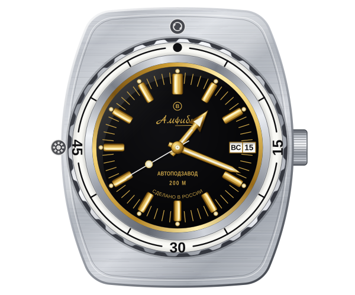

# Vostok Amphibia Widget

🇮🇹 [Italiano](#italiano) · 🇬🇧 [English](#english) · 🇷🇺 [Русский](#русский)

---

## Italiano

Widget da scrivania (Python + PyQt6) che ricrea in digitale l'orologio **Vostok Amphibia 090679**: cassa tonneau, ghiera dentellata girevole, corona estraibile, retro con fondello svitabile e movimento a vista.

### Download
- **Windows:** scarica `VostokWidget.exe` dalla pagina [Releases](../../releases) e avvialo. Non serve installare nulla.
  Al primo avvio Windows SmartScreen può mostrare un avviso (l'eseguibile non è firmato): *Ulteriori informazioni → Esegui comunque*.
- **Linux / macOS:** `pip install PyQt6` e poi `python3 vostok_widget.py`.

### Comandi
| Azione | Effetto |
|---|---|
| Trascina su quadrante/cassa | sposta l'orologio |
| Trascina sulla ghiera | ruota la ghiera (scatti di 1 minuto) |
| Click sulla corona | la estrae: 0 → 1 → 2 → 0 |
| Rotella sulla corona (pos. 1) | corregge giorno e data |
| Rotella sulla corona (pos. 2) | regola ore e minuti |
| Rotella altrove | zoom |
| Icona in alto | gira l'orologio (fronte/retro) |
| Icona in basso (retro) | svita/avvita il fondello |
| Click sul meccanismo a vista | lo carica (rotore e bilanciere) |
| Icona a sinistra | impostazioni (quadrante, ghiera, dedica, avvio automatico) |
| Click centrale | prova dell'allarme |
| Click destro | chiude |

**Allarme:** metti il puntino nero della ghiera dopo la lancetta dei minuti; al passaggio l'orologio suona e vibra per 10 secondi.

C'è anche una sorpresa nascosta. 😉

📖 Manuale completo: [docs/Vostok_Widget_Manuale_v4.pdf](docs/Vostok_Widget_Manuale_v4.pdf)

---

## English

Desktop widget (Python + PyQt6) recreating the **Vostok Amphibia 090679** watch: tonneau case, rotating notched bezel, pull-out crown, flip-side view with a screw-off caseback and visible movement.

### Download
- **Windows:** get `VostokWidget.exe` from [Releases](../../releases) and run it — no installation needed. SmartScreen may warn because the file is unsigned: *More info → Run anyway*.
- **Linux / macOS:** `pip install PyQt6`, then `python3 vostok_widget.py`.

Drag the bezel to rotate it, click the crown to pull it out (pos. 1: day/date, pos. 2: time, set with the mouse wheel), use the top icon to flip the watch, the left icon for settings, right-click to close. Set the bezel dot after the minute hand for a 10-second alarm. There's also a hidden surprise.

---

## Русский

Виджет для рабочего стола (Python + PyQt6), воссоздающий часы **Восток Амфибия 090679**: корпус-бочка, вращающийся безель, выдвижная заводная головка, обратная сторона с откручивающейся крышкой и видимым механизмом.

- **Windows:** скачайте `VostokWidget.exe` в разделе [Releases](../../releases).
- **Linux / macOS:** `pip install PyQt6`, затем `python3 vostok_widget.py`.

---

Autore / Author: **Dmitrij Musella** · Licenza MIT.
Font "Marck Script" © Denis Masharov & Marck Fogel, SIL Open Font License 1.1.
Progetto amatoriale non affiliato a Vostok. / Fan project, not affiliated with Vostok.
